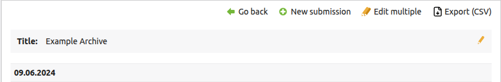

# Submissions
A generic module to store form submissions in Contao using DCA fields with a JSON fallback for freely named fields.

## Features

- Directly store form generator submissions (with included form type)
- Submissions organized in archives using a dedicated DCA including permissions handling
- Highly customizable: define new fields on the data container.
- Auto-creates palettes for your fields.
- Bundles double opt-in process.
- Export your submissions as (excel compatible) CSV
- Notification Center 2.0 support ([terminal42/contao-notification_center](https://github.com/terminal42/contao-notification_center))
- Integrated support for following extensions:
  - [Contao Fieldset Duplication](https://packagist.org/packages/inspiredminds/contao-fieldset-duplication) - store data as blob for group widget, multi column editor or multi column wizard fields.

## Install

1. Install with composer or contao manager

```bash
composer require heimrichhannot/contao-submissions
```

2. Update database

## Usage

In the backend, you will find a new menu item called “Submissions”. Create a new archive with a title and select the
fields that should be contained in your submissions.

### Form generator
You can save your form generator submissions directly as a submission. Simply activate "Save as submission" and select
the submission archive. Form fields matching a DCA field on `tl_submission` are stored in their existing database columns.
Values without a matching DCA field are automatically stored as a JSON object in `additionalData`. Update the database
after installing this feature. Existing submissions have `NULL` in this column.

Binary Contao UUIDs are converted to string UUIDs before JSON encoding, including values in nested and serialized arrays.
Serialized widget values remain serialized. The names `additionalData`, `additionalDataMeta` and `additionalDataView` are reserved and cannot be used as form fields.
Additional values appear in the read-only **Additional form data** section of the submission editor. Field labels, field
types and selected option labels are snapshotted in `additionalDataMeta` when submitting, including dynamically provided
options. Uploaded file names are also kept for readable file references, without exposing download URLs. Later changes to
the form do not change these snapshots. Existing submissions without metadata display readable field names and stored values.
Lists, repeated groups and serialized widget values are formatted for reading. Empty sections are hidden.
Non-admin editors need the **Additional form data** field (`tl_submission::additionalDataView`) enabled in their user
or user group's allowed fields, in addition to access to the submission archive.
CSV export, title patterns and opt-in notifications still use the existing DCA fields. Fields defined in the DCA without a database column are not considered additional fields.

Use `##form_attachment_*##` tokens in your notification center notifications to include attachments in your emails.

### Opt in process

Use the built-in double opt-in process to verify submissions.
Create an opt-in challenge notification in notification center and select it on your form in the form generator.
You can also define a jump to page to which the user is redirected when the opt-in is successful.
If you want to bump a property at successful opt-in, set a boolean confirmation field (i.e. to set the field `publish` to true).

Use the following notification tokens in the opt-in notification:

| Token             | Description                                                                                                              |
|-------------------|--------------------------------------------------------------------------------------------------------------------------|
| `##optin_token##` | To be replaced with the opt-in token                                                                                     |
| `##optin_url##`   | To be replaced with the absolute opt-in url                                                                              |
| `##email##`       | Same as `##form_email##`, but guaranteed to be in a valid email address format. Intended use as recipient email address. |


### Export

Active "Allow export" in the submission archive settings to enable CSV export of submissions.
Afterwards you will find an "Export" button in the submission list view.



## Development

### Tests

Run `composer test` for the regression tests. Set `SUBMISSIONS_TEST_DATABASE_URL` to a MariaDB/MySQL database URL to also
run the database and Contao storage-hook integration tests. These tests use temporary tables on their own connections.

### Fields on tl_submission

Take a look at [`dca/tl_submission.php`](https://github.com/heimrichhannot/contao-submissions/blob/master/dca/tl_submission.php#L94) for all available fields.

Adjust the dca to your needs.

Mark fields as `noSubmissionField` to make them unavailable for use as submission fields.

```php
$dca = &$GLOBALS['TL_DCA']['tl_submission'];

$dca['fields']['my_field']['eval']['noSubmissionField'] = true;
```

### Events

| Event                                              | Description                                                                     |
|----------------------------------------------------|---------------------------------------------------------------------------------|
| SubmissionsBeforeSendConfirmationNotificationEvent | Dispatched before success notification is sent. Requires enabled double opt-in. |
